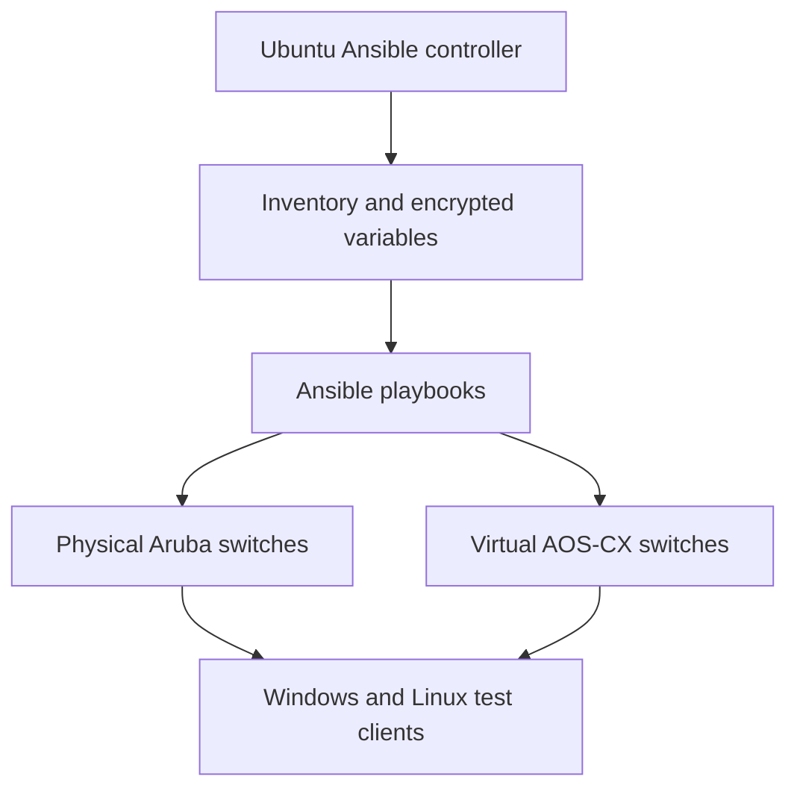

# Network Automation and Switching Lab

**Ansible · Aruba AOS-CX/AOS · VLANs · DHCP · LACP · SSH/SFTP · VMware**

An academic networking lab completed as part of **APL701 – Applied Integration** in Seneca Polytechnic's Computer Systems Technology program. The exercise involved using an Ubuntu-based Ansible controller to automate switch configurations, implement segmented networks, manage configuration backups, and verify connectivity between Windows and Linux test clients.

> **Repository scope:** This README documents the lab work and technical concepts I practiced. I no longer have my original Ansible playbooks or switch configuration exports, so this repository is a project write-up rather than a runnable automation package. Instructor-provided reference files and another student's documentation are not reproduced here.

## Objectives

- Use Ansible to apply repeatable configurations across multiple network switches.
- Configure VLANs, access and trunk ports, IP addressing, and DHCP services.
- Implement link aggregation using LACP where required by the topology.
- Back up and restore switch configurations through secure file transfer.
- Protect automation credentials with Ansible Vault and use SSH for management access.
- Verify addressing and connectivity across Windows and Linux clients.

## Lab Environment

| Component | Purpose |
| --- | --- |
| Ubuntu virtual machine | Ansible control node and SSH/SFTP endpoint |
| Aruba 6300 series switches | Physical switching and AOS-CX configuration exercises |
| Aruba 2540 series switch | Additional physical switching and trunking exercises using ArubaOS-Switch |
| Virtual AOS-CX switches | Virtualized switch configuration and automation |
| VMware Workstation | Virtual machines and isolated network segments |
| Windows, Ubuntu, and Kali Linux clients | DHCP and network connectivity validation |
| Ansible Vault | Encryption of sensitive automation variables |

**Networking concepts:** TCP/IP, IPv4 subnetting, VLANs, tagged and untagged ports, DHCP, trunking, link aggregation (LACP), SSH, SFTP, and network troubleshooting.

## Architecture Overview

The controller managed switch settings through supported Ansible network modules and CLI commands. SSH/SFTP was used for configuration transfers on physical equipment; the virtual AOS-CX environment also supported automation through platform-specific modules.

## Implementation

### 1. Independent switch configurations

- Worked with separate switch configurations containing multiple VLANs and access ports.
- Defined VLAN interfaces and IPv4 address ranges for client networks.
- Configured DHCP pools to allocate addresses to connected clients.
- Practiced saving startup configurations and restoring earlier configurations after changes.

### 2. Linked physical switches

- Configured a topology involving physical Aruba switches with VLANs carried across a trunk.
- Used LACP link aggregation to combine switch ports into a logical uplink.
- Tested DHCP assignment and communication between clients attached to different switches.
- Practiced inspecting configuration differences before restoration.

### 3. Virtual switching environment

- Worked with virtual AOS-CX switches connected through isolated VMware LAN segments.
- Configured VLAN interfaces, trunk membership, and link aggregation.
- Applied DHCP and relay-related settings appropriate to the test topology.
- Used Windows and Linux virtual machines to validate addressing and connectivity.

### 4. Automation and configuration recovery

The automation workflow included:

1. Defining switch groups and connection settings in Ansible inventory.
2. Keeping sensitive variables separate from playbooks and protecting them with Ansible Vault.
3. Running configuration playbooks against the intended switch groups.
4. Downloading switch configuration backups through SSH/SFTP where supported.
5. Restoring configurations and checking the resulting switch and client behavior.

## Validation

| Check | What it verified |
| --- | --- |
| Client IP address inspection | DHCP allocated an address in the intended subnet |
| VLAN and interface inspection | Access/trunk assignments matched the topology |
| LAG/LACP status | Aggregated uplinks were configured as intended |
| ICMP connectivity tests | Test clients could reach the expected destinations |
| Configuration backup and restore | Switch settings could be recovered after changes |

This section documents the validation activities practiced during the lab; it does not claim that the original device output or test logs are preserved in this repository.

## Security and Operational Considerations

- **Secrets:** Ansible Vault was used to avoid keeping sensitive passwords directly in playbook text.
- **Configuration transfer:** SFTP provided an encrypted alternative to plaintext file-transfer methods.
- **Access management:** SSH settings and network-device permissions affected which automation methods were available.
- **Legacy equipment:** Some lab switches required compatibility settings for older SSH algorithms. Such exceptions should be isolated, risk-assessed, and avoided on modern production systems wherever possible.
- **GitHub hygiene:** Credentials, private SSH keys, vault passwords, unredacted inventory files, and internal network details should not be committed to a public repository.

## What I Learned

- How network automation reduces repetitive switch configuration work.
- How VLANs, DHCP, trunking, and LACP fit together in a multi-switch topology.
- How to troubleshoot connectivity systematically using addressing, interface configuration, and client-side tests.
- Why configuration backups and controlled restoration matter during network changes.
- How device operating systems and permissions influence the available automation approach.

## Repository Status and Attribution

This repository contains **documentation only**. My original configuration files and screenshots from the lab are not available, and I have intentionally not presented instructor-supplied sample files as my own source code.

The work was performed as part of **Seneca Polytechnic's APL701 – Applied Integration** coursework. The lab requirements and reference materials were provided for academic instruction. This README is a summary of the network-automation exercise I completed, written for portfolio purposes.

The switch platforms in this lab were **Aruba AOS/AOS-CX**, not Cisco IOS. The project demonstrates transferable switching and network-automation concepts, but it should not be interpreted as a Cisco certification or production deployment.
